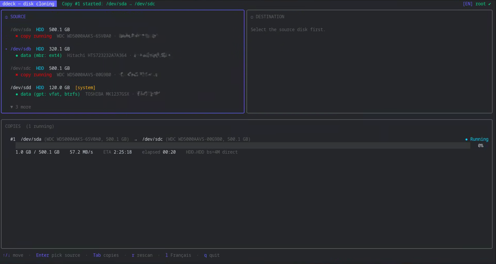
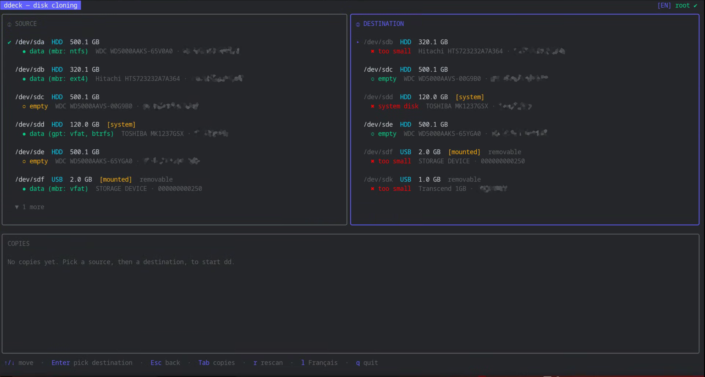
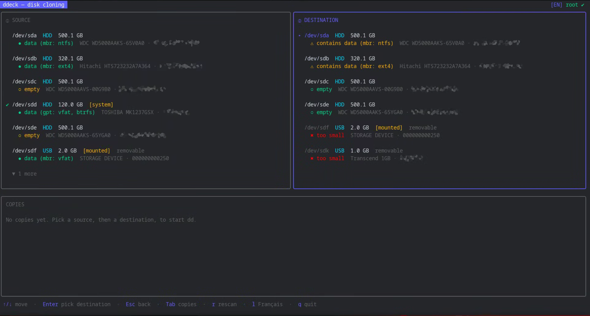
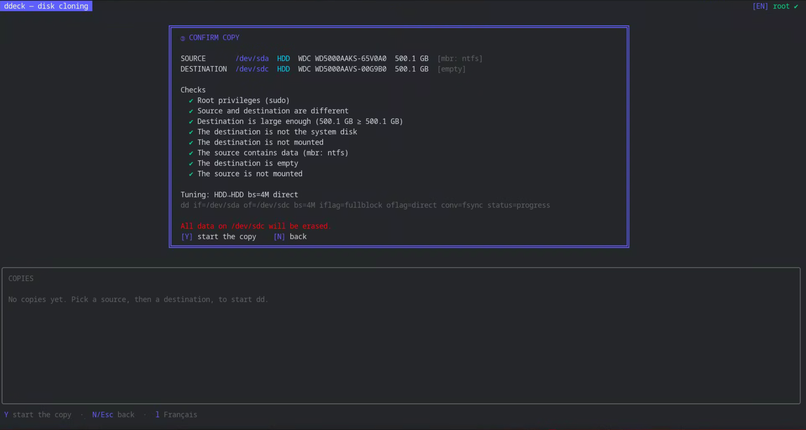
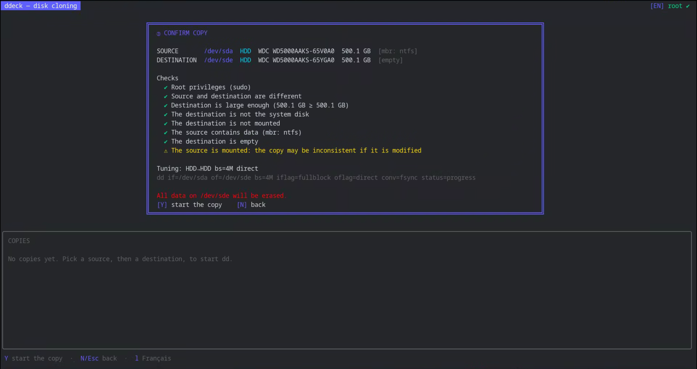
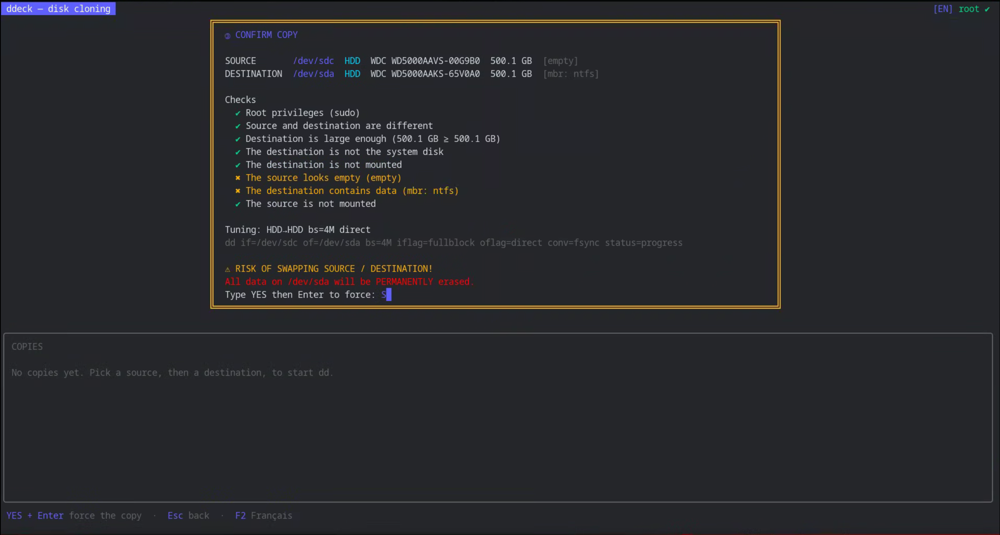
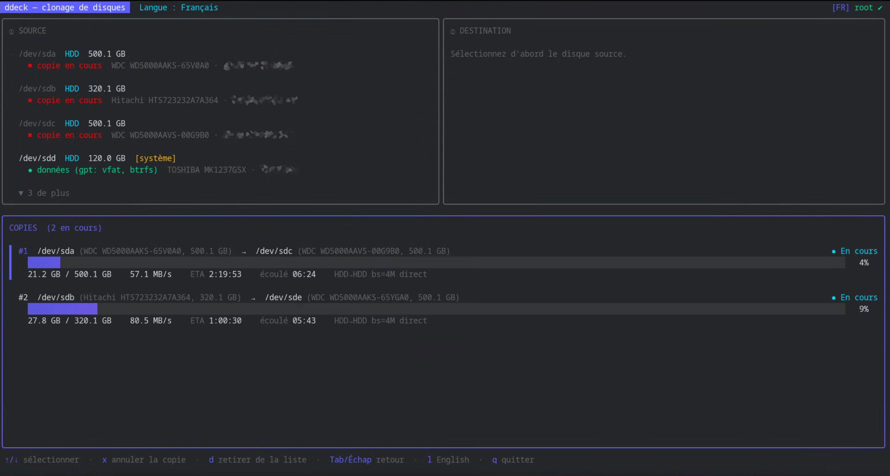

# ddeck — clonage de disques avec `dd`, en TUI

🇬🇧 [English version](README.md)

ddeck est une interface texte (Linux) pour `dd` :



L'interface est en anglais par défaut. Appuyez sur `l` (ou `F2`) à tout moment pour passer en français, et inversement.

## Pourquoi ddeck plutôt que `dd` seul ?

`dd` est puissant mais impitoyable : une faute de frappe dans `of=` et c'est le mauvais disque qui est effacé, sans avertissement. ddeck garde la puissance de `dd` et ajoute la sécurité et le confort qui lui manquent.

- **Aucun chemin de périphérique à taper** : on choisit les disques dans une liste qui affiche le modèle, la taille, le type (NVMe, SSD, HDD, USB, SD) et le numéro de série. Fini les confusions entre `/dev/sdb` et `/dev/sdc`.
- **Protection contre l'erreur classique** : l'inversion source / destination. ddeck examine le contenu réel des deux disques. Si la source paraît vide, ou si la destination contient des données, il faut taper un mot de confirmation.
- **Les copies dangereuses sont tout simplement impossibles** : le disque système, un disque monté ou un disque trop petit ne peuvent jamais être choisis comme destination.
- **De bons réglages sans être expert** : la taille de bloc et les options sont choisies selon le matériel. Les copies vont plus vite qu'avec le bloc de 512 octets par défaut de `dd`, et les données sont réellement écrites sur le disque (`conv=fsync`) avant que ddeck annonce « terminée ».
- **Une vraie progression** : pourcentage, vitesse, temps restant (ETA) et durée écoulée, au lieu du simple compteur d'octets de `dd`. Grâce à `oflag=direct`, la progression montre ce qui est réellement écrit, pas ce qui attend dans le cache.
- **Plusieurs clonages en même temps** : on lance une copie, puis une autre aussitôt, et on les suit toutes dans la même fenêtre. Les disques déjà utilisés ne peuvent pas être choisis deux fois.
- **Annulation propre** : on annule une copie (`x`) sans arrêter les autres. Quitter pendant des copies demande d'abord une confirmation.
- **Transparent** : la commande `dd` exacte est affichée avant chaque copie. On sait ce qui va tourner, et on peut la réutiliser dans un script.
- **Facile à déployer** : un seul binaire statique, sans dépendances. La machine cible n'a besoin que de `lsblk` et `dd`, présents sur presque tous les Linux. Sans root, ddeck fonctionne quand même en lecture seule pour examiner les disques.
- **Anglais ou français** : on change de langue à tout moment avec `l`.

## Ce que fait l'application

- **Les 3 cadres** : la source en haut à gauche, la destination en haut à droite (sans le disque source), les copies en bas. Chaque copie occupe 3 lignes : les disques, la barre de progression, puis volume copié, vitesse, ETA, durée écoulée et options utilisées.
- **Détection** de tous les disques via `lsblk` : SATA, NVMe, USB, SD/MMC et loop. Les snaps et le zram sont ignorés.
- **Protection contre l'inversion** : à la confirmation, ddeck relit les deux disques. Il cherche une table de partitions, des systèmes de fichiers, et lit des échantillons au début, au milieu et à la fin du disque. Si la source paraît vide, ou si la destination n'est pas vide, il faut taper `OUI` (ou `YES` en anglais) pour forcer.
- **Blocages sans possibilité de forcer** : lancement sans root, destination montée, destination trop petite, ou destination qui est le disque système.
- **Options de `dd` adaptées au matériel** : c'est le disque le plus lent qui fixe la taille de bloc (voir le tableau ci-dessous).
- **Plusieurs copies en même temps** : une fois une copie lancée, on revient au choix de la source. Les disques déjà pris par une copie ne sont plus sélectionnables.

## Déroulement

Les captures ci-dessous sont en anglais, la langue par défaut ; la touche `l` passe l'interface en français, comme sur la capture du haut.

1. **Source** (cadre en haut à gauche) : choisir le disque à copier.
2. **Destination** (cadre en haut à droite) : choisir le disque à écraser. Le disque système, les disques trop petits et ceux déjà pris par une copie ne sont pas sélectionnables.

   

   Les disques qui contiennent déjà des données sont signalés par ⚠ : on voit le risque avant de choisir.

   

3. **Confirmation** : récapitulatif des deux disques, des vérifications et de la commande `dd` retenue. `O` pour lancer (`Y` en anglais).

   

   Les points mineurs apparaissent en jaune sans bloquer la copie, par exemple une source montée :

   

   Si la source paraît vide ou si la destination contient des données, ddeck soupçonne une inversion et demande de taper `OUI` + Entrée (`YES` en anglais) :

   

4. **Copies** (cadre du bas) : suivi de la copie. On peut aussitôt en lancer une autre ; elle s'ajoute en dessous.

   

## Options dd selon le matériel

| Le plus lent | bs  | Lecture directe |
|--------------|-----|-----------------|
| NVMe         | 16M | oui (si les deux disques sont SSD/NVMe) |
| SSD SATA     | 8M  | oui (si les deux disques sont SSD/NVMe) |
| HDD/USB/SD   | 4M  | non             |

Options toujours présentes : `iflag=fullblock oflag=direct conv=fsync status=progress`.

## Installation

Il faut Go ≥ 1.22. Depuis Windows, macOS ou Linux :

```
CGO_ENABLED=0 GOOS=linux GOARCH=amd64 go build -trimpath -ldflags=-s -o ddeck .
```

On obtient un binaire statique sans dépendances. Il faut juste `lsblk` et `dd` sur la machine cible.

```
sudo ./ddeck
```

## Touches

| Touche  | Action |
|---------|--------|
| ↑/↓ j/k | naviguer |
| Entrée  | valider |
| Échap   | étape précédente |
| Tab     | aller dans le cadre Copies et en revenir |
| x       | annuler la copie sélectionnée (cadre Copies) |
| d       | retirer une copie terminée de la liste |
| r       | relancer la détection des disques |
| l / F2  | changer de langue anglais ⇄ français (`F2` marche aussi pendant la saisie de `OUI`) |
| q       | quitter (confirmation demandée si des copies tournent) |

## Tester sans risque (loop devices)

```
truncate -s 512M src.img dst.img
sudo losetup -fP --show src.img     # → /dev/loopX
sudo losetup -fP --show dst.img     # → /dev/loopY
sudo parted -s /dev/loopX mklabel gpt mkpart p ext4 1MiB 100%
sudo mkfs.ext4 /dev/loopXp1
sudo ./ddeck                        # loopX → loopY
cmp src.img dst.img && echo identiques
```

## Licence

[MIT](LICENSE)

## Développement

```
go vet ./... && go test ./...
```

- [internal/disk/](internal/disk/) : détection (`lsblk`) et inspection du contenu
- [internal/dd/](internal/dd/) : choix des options et exécution de `dd`
- [internal/ui/](internal/ui/) : interface Bubble Tea
- [internal/i18n/](internal/i18n/) : langue courante (anglais/français)
